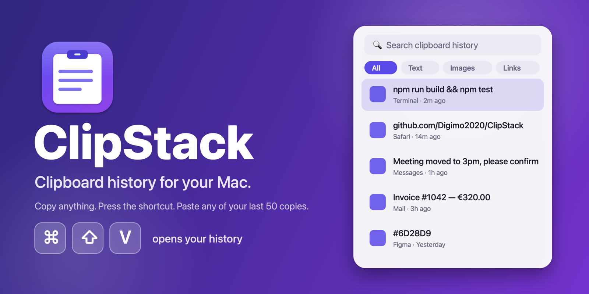

<p align="center">
  
</p>

<h1 align="center">ClipStack</h1>

<p align="center">
  <a href="https://github.com/Digimo2020/ClipStack/releases/latest"></a>
  <a href="https://github.com/Digimo2020/ClipStack/commits/main"></a>
  <a href="https://github.com/Digimo2020/ClipStack/releases/latest"></a>
  
  <a href="LICENSE"></a>
</p>

<p align="center">
  A tiny, fast clipboard history for macOS. Press <kbd>⌘</kbd> <kbd>⇧</kbd> <kbd>V</kbd> and paste anything you copied recently.<br>
  Like Windows + V, for your Mac.
</p>

<p align="center">
  <a href="https://github.com/Digimo2020/ClipStack/releases/latest"><b>⬇ Download the latest DMG</b></a>
</p>

---

## Features

- **Clipboard history**: keeps your last 50 copies (set anywhere from 20 to 200). Text and images.
- **One shortcut**: <kbd>⌘</kbd><kbd>⇧</kbd><kbd>V</kbd> opens a floating panel. Change it in Settings.
- **Paste instantly**: press <kbd>⏎</kbd> or click an item and it is pasted into the app you were using.
- **Search and filters**: type to search, or filter by All, Text, Images, Links, Pinned.
- **Pin favourites**: pinned items are never removed.
- **Private by design**: everything stays on your Mac. Passwords copied from password managers are ignored, and you can pause capturing any time.
- **Native and light**: Swift and SwiftUI, lives in the menu bar, no Dock icon, dark mode supported.

## Install (step by step)

**Requirements:** macOS 14 Sonoma or newer (Apple Silicon).

1. **Download** `ClipStack.dmg` from the [latest release](https://github.com/Digimo2020/ClipStack/releases/latest).
2. **Open the DMG** and drag **ClipStack** onto the **Applications** folder.
3. **First launch.** ClipStack is not notarized by Apple (that needs a paid developer account), so macOS shows *"Apple could not verify ClipStack…"*. This is expected. Do either of these once:
   - Click **Done**, open **System Settings → Privacy & Security**, scroll down to *"ClipStack was blocked"* and click **Open Anyway**; or
   - run this in Terminal:
     ```bash
     xattr -dr com.apple.quarantine /Applications/ClipStack.app
     ```
4. **Open ClipStack again.** A clipboard icon appears in your menu bar.
5. **Allow auto-paste (optional but recommended).** The first time you pick an item, macOS asks for **Accessibility** permission. Turn ClipStack on in *System Settings → Privacy & Security → Accessibility*. Without it, ClipStack still copies the item and you press <kbd>⌘V</kbd> yourself.
6. **Try it.** Copy a few things, press <kbd>⌘</kbd><kbd>⇧</kbd><kbd>V</kbd>, pick one.

## Keyboard shortcuts

| Key | Action |
| --- | --- |
| <kbd>⌘</kbd><kbd>⇧</kbd><kbd>V</kbd> | Open or close the history |
| <kbd>↑</kbd> <kbd>↓</kbd> | Move the selection |
| <kbd>⏎</kbd> | Paste the selected item |
| <kbd>⌘</kbd><kbd>1</kbd> – <kbd>9</kbd> | Paste item 1–9 directly |
| <kbd>⌘</kbd><kbd>P</kbd> | Pin or unpin |
| <kbd>⌘</kbd><kbd>⌫</kbd> | Delete the selected item |
| <kbd>Esc</kbd> | Close |

> **Why not just ⌘V?** <kbd>⌘</kbd><kbd>V</kbd> is the system Paste shortcut, so taking it over would break pasting everywhere. In Settings you can pick another combination: ⌘⌥V, ⌃⇧V, ⌃⌥V or ⌥V.

## Settings

Click the menu bar icon → **Settings…**

- Shortcut preset
- History size (20 – 200 items)
- Pause capturing, clear history (pinned items are kept)
- Launch at login
- Accessibility status

## Build from source

You need Xcode command line tools (Swift 5.9+).

```bash
git clone https://github.com/Digimo2020/ClipStack.git
cd ClipStack
./build.sh --install      # builds, copies to /Applications and launches
./scripts/make_dmg.sh     # optional: build/ClipStack.dmg
```

Set a version with `VERSION=1.2 ./build.sh`.

Maintainers: `./scripts/release.sh patch "what changed"` bumps `VERSION`, builds, pushes and publishes the GitHub release in one step.

## Privacy

ClipStack has no network code, no analytics and no accounts. History is stored locally in `~/Library/Application Support/ClipStack/`. Items marked as concealed or transient by other apps (for example password managers) are never saved.

## Troubleshooting

- **The shortcut does nothing.** Another app may use the same keys. Pick a different one in Settings.
- **It copies but does not paste.** Grant Accessibility permission (step 5). After updating the app you may need to remove and re-add it in that list.
- **"ClipStack is damaged" or "can't be opened".** Run the `xattr` command from step 3.

## License

[MIT](LICENSE) © Kazi Fahim · [GitHub @Digimo2020](https://github.com/Digimo2020)
