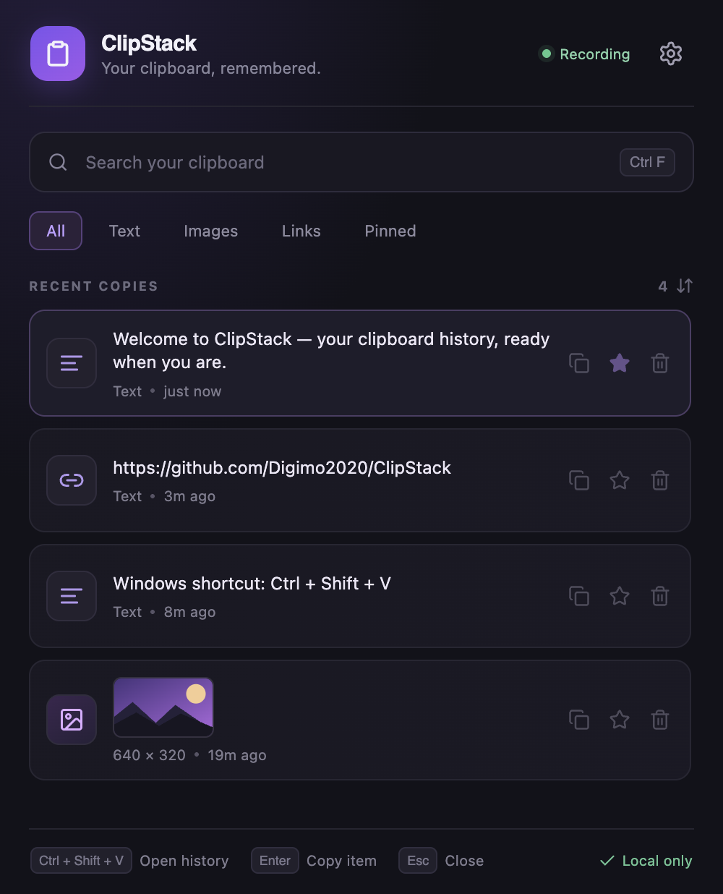
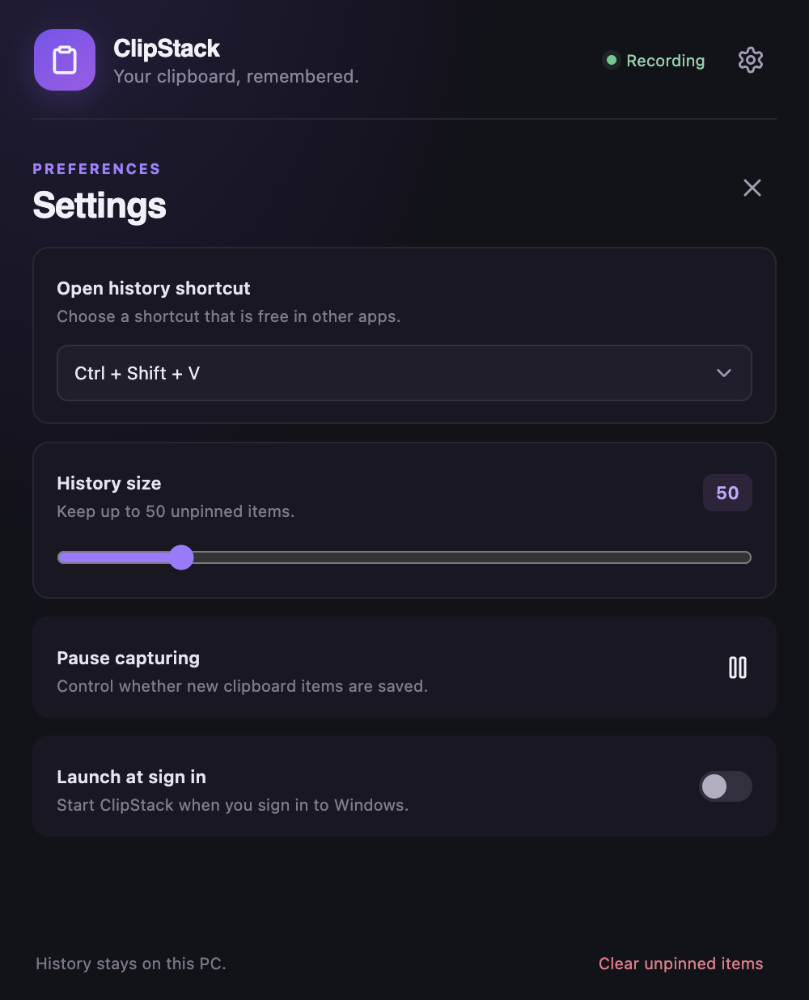

# ClipStack for Windows

ClipStack keeps a searchable local history of text and images copied on Windows. It sits in the notification area and opens from a configurable keyboard shortcut.

## Download and install

1. Get [ClipStack-Setup.exe](https://github.com/Digimo2020/ClipStack/releases/latest/download/ClipStack-Setup.exe) from the public GitHub release.
2. Run the installer. It installs for your Windows account and does not need administrator access.
3. If SmartScreen displays a warning for this unsigned app, review the publisher prompt and choose **More info → Run anyway** to continue.
4. Open ClipStack from the Start menu. Its clipboard icon appears by the clock. If hidden, open the notification area's `^` menu.

## Use history

1. Copy text or an image in any application.
2. Press **Ctrl+Shift+V** to open ClipStack.
3. Search, choose **All**, **Text**, **Images**, **Links** or **Pinned**, then select a result.
4. ClipStack copies the selected item. Press **Ctrl+V** in the app where you want to paste it.
5. Use the star to pin an item. Pinned items stay when the history limit is reached or unpinned history is cleared.

## Shortcuts and settings

The default shortcut is **Ctrl+Shift+V**. In Settings, choose **Ctrl+Alt+V** or **Alt+V** if another app already uses it. ClipStack does not take over Windows **Win+V** or **Ctrl+V**.

Settings also let you set the history limit from 20 to 200 unpinned items, pause capture, clear unpinned items, and launch ClipStack at sign-in. Press **Escape** to close the history window; use **Up/Down** and **Enter** to select and copy.

## Privacy and storage

ClipStack does not upload clipboard contents. History is kept in `%APPDATA%\ClipStack\` in a JSON file with separate image files. Items marked by Windows as excluded from clipboard monitoring are skipped when that marker is available.

## Screenshots and full guide

The screenshots below contain sample text and show the Windows edition's shared React interface.

See the [ClipStack Setup Guide PDF](../docs/ClipStack-Setup-Guide.pdf) for the illustrated setup and usage steps.
